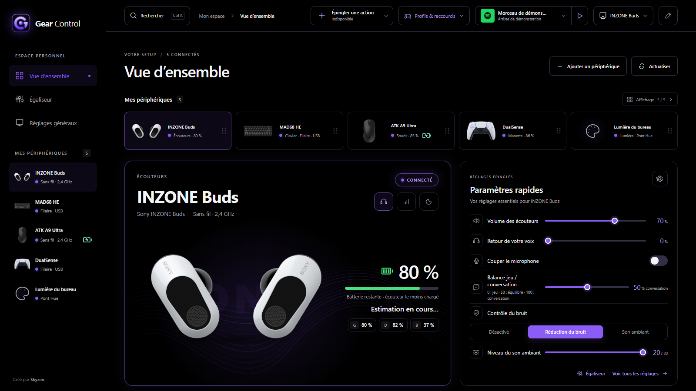
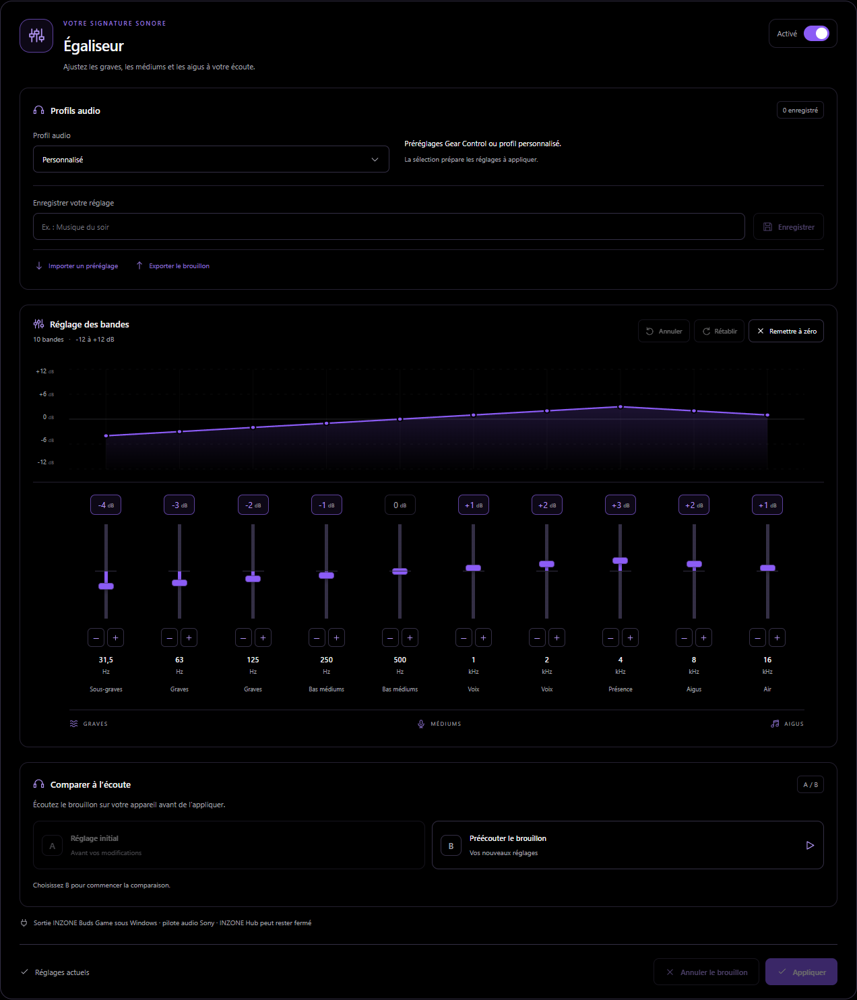
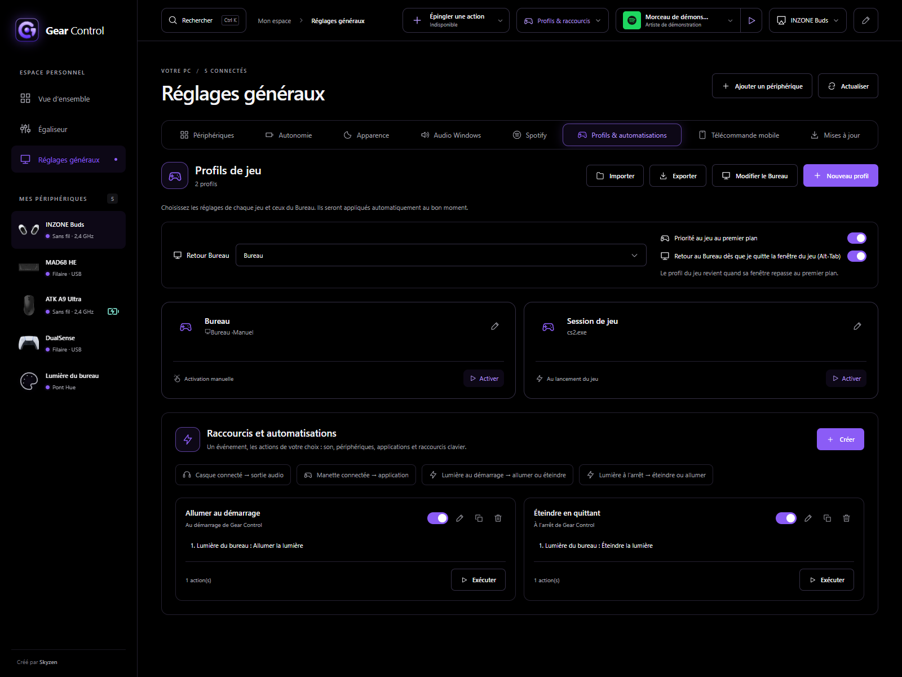
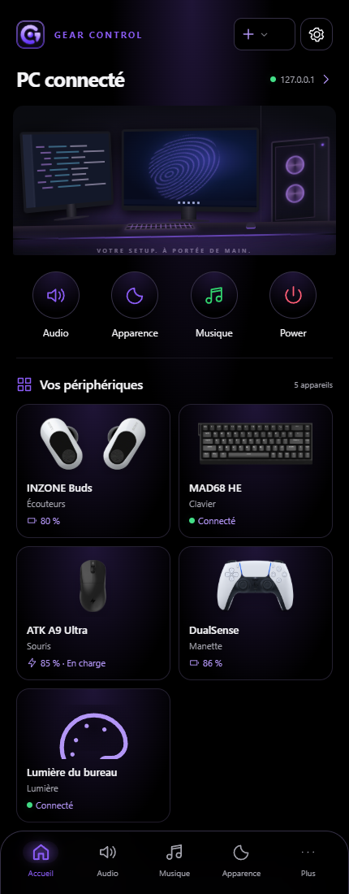
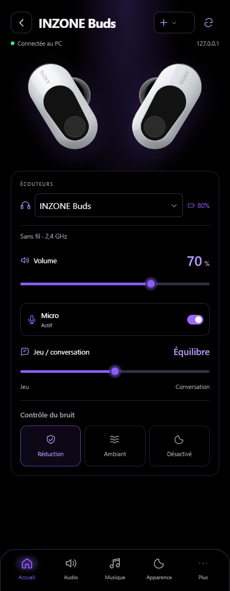
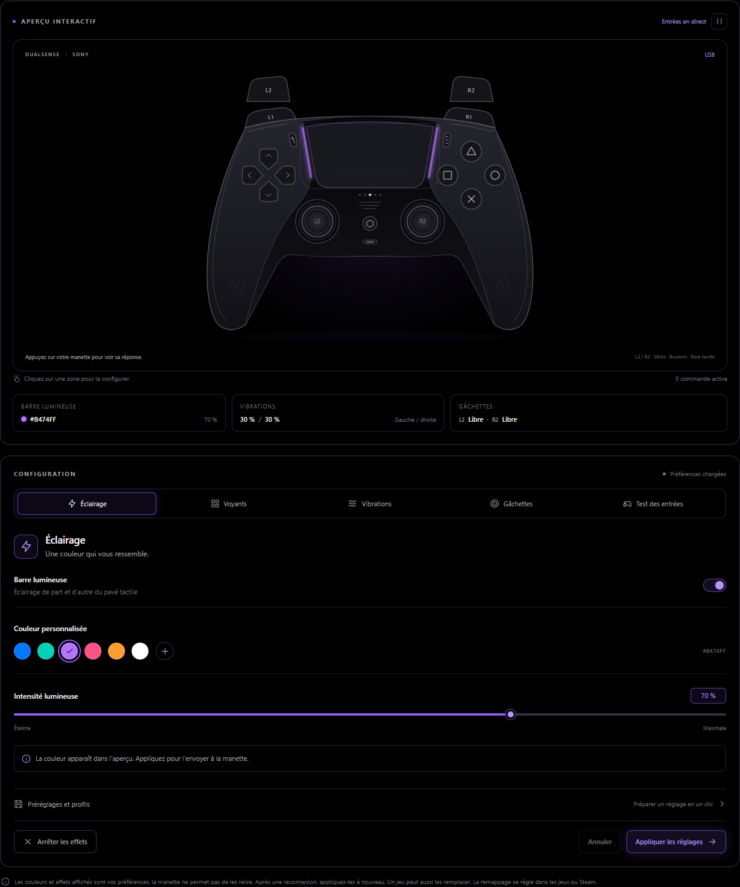

<h1 align="center">Gear Control</h1>

<strong>Vos périphériques. Vos réglages. Un seul hub.</strong>

Un logiciel Windows avec une interface web locale pour réunir votre équipement, personnaliser vos réglages et piloter votre PC depuis votre téléphone.

  
  
  

<a href="#installation">Installation</a> · <a href="#fonctionnalités">Fonctionnalités</a> · <a href="#en-images">En images</a> · <a href="#compatibilité">Compatibilité</a> · <a href="https://github.com/Skyzenfr/gear-control/issues">Assistance</a>

---

Gear Control rassemble les batteries, l’audio, les réglages des périphériques et les automatisations dans une interface sombre personnalisable. Composez votre espace avec les appareils que vous utilisez, puis retrouvez leurs commandes au même endroit.

Le logiciel fonctionne sur votre PC. Son interface s’ouvre dans votre navigateur et sa télécommande mobile peut être activée sur votre réseau local. **Aucun compte Gear Control ni abonnement n’est nécessaire pour régler vos périphériques.**

## Fonctionnalités

| Votre besoin | Avec Gear Control |
| --- | --- |
| Retrouver tout votre équipement | Ajoutez, renommez et organisez vos appareils ; consultez leur connexion et leur batterie lorsqu’elle est disponible. |
| Ajuster votre son | Changez de sortie audio, gérez le volume Windows et des applications, puis réglez l’égaliseur des appareils compatibles. |
| Personnaliser vos périphériques | Accédez aux DPI, à la fréquence USB, à l’éclairage, aux commandes de manette et aux réglages proposés par chaque adaptateur. |
| Adapter votre installation à chaque jeu | Créez des profils de jeu et un profil Bureau ; retrouvez le profil Bureau au changement de fenêtre ou à la fermeture du jeu. |
| Automatiser les gestes répétitifs | Combinez événements, horaires et actions : réglages, sortie audio, application, raccourci clavier ou lumière compatible. |
| Garder les commandes à portée de main | Utilisez les réglages épinglés, les actions Stream Deck et la télécommande sur téléphone. |
| Conserver votre configuration | Sauvegardez et restaurez vos réglages ; consultez les mises à jour et l’historique des versions depuis le hub. |

## En images

### Votre signature sonore

Un égaliseur visuel, des préréglages et des profils personnels pour les appareils pris en charge.

### Des automatisations pour votre installation

Préparez vos actions au démarrage et à l’arrêt de Gear Control, ou déclenchez-les selon vos périphériques et vos applications. Ici, deux règles de démonstration contrôlent une lumière.

### Une télécommande dans votre poche

Activez la télécommande, associez votre téléphone par QR code et accédez aux commandes essentielles depuis le même réseau local. L’égaliseur et les réglages avancés restent sur le PC.

  
  

### Une vue interactive de votre DualSense

L’aperçu de la manette accompagne les réglages et le diagnostic des entrées : boutons, sticks et gâchettes, selon les rapports disponibles.

Captures réalisées le 24 octobre 2026 à partir d’une compilation fraîche de l’interface actuelle, avec des données de démonstration. Les commandes disponibles dépendent du matériel connecté.

## Installation

1. Téléchargez **`GearControl-Setup-<version>.exe`** depuis [la dernière version publiée](https://github.com/Skyzenfr/gear-control/releases/latest).
2. Installez le logiciel sur **Windows 10 ou 11, 64 bits**. Node.js est inclus ; l’installation de base se fait pour votre compte, sans droits administrateur.
3. Ouvrez **Gear Control** depuis le menu Démarrer, ou choisissez **Ouvrir le hub** dans son icône près de l’horloge.
4. Retrouvez votre interface sur **[http://127.0.0.1:3210](http://127.0.0.1:3210)** et choisissez vos appareils dans l’assistant.

Vous pouvez ajouter d’autres appareils plus tard dans **Réglages généraux → Périphériques**. Fermer la page web laisse le logiciel actif ; **Quitter**, dans le menu de l’icône, arrête le service.

L’installateur ne dispose pas de signature commerciale : Windows peut afficher un avertissement SmartScreen à la première exécution.

## Le logiciel et son interface web

| Sur votre PC | Sur votre téléphone |
| --- | --- |
| Le logiciel Windows communique avec les appareils compatibles et conserve votre configuration. | La télécommande se connecte à votre PC sur le réseau local, après activation et association. |
| L’interface web locale donne accès aux réglages, profils, automatisations et mises à jour. | Les commandes essentielles restent accessibles dans le navigateur du téléphone. |
| L’interface PC est disponible en français et en anglais. | La télécommande est actuellement en français. |

Sur iPhone, le [scanner HTTPS Gear Control](https://gear-control-scanner.maximemeyre.chatgpt.site) peut aider à lire le QR code depuis le parcours d’association. Il sert à scanner le lien de connexion ; les commandes passent ensuite par le réseau local. La caméra et le décodage restent sur le téléphone. Internet est nécessaire pour charger ce scanner.

## Compatibilité

La reconnaissance d’un appareil et les réglages disponibles dépendent du modèle, du protocole et des capacités réellement annoncées. **La présence d’une marque dans cette liste ne signifie pas que toute sa gamme est prise en charge.**

| Famille | Exemples d’intégrations et de fonctions |
| --- | --- |
| Audio | Logitech G FITS, Sony INZONE Buds, Creative Pebble Pro, SC440 ; commandes audio Windows et égaliseur Sony sous conditions. |
| Souris | ATK A9 Ultra, Logitech HID++ 2 et Razer DeathAdder V4 Pro ; autres souris Razer selon les fonctions reconnues. |
| Claviers | MAD68 HE, éclairage Wooting RGB ; fonctions partielles pour certains claviers QMK/VIA. |
| Manettes | DualSense : aperçu, entrées, éclairage, vibrations et gâchettes ; fonctions partielles pour DualShock 4 et XInput. |
| Écrans et webcams | Réglages DDC/CI et UVC ; extensions ASUS et AOC/AGON selon le modèle, avec prise en charge partielle. |
| Commandes et éclairage | Plusieurs modèles Stream Deck ; lumières Philips Hue via un pont ; éclairage via le serveur SDK OpenRGB. |

Certains adaptateurs sont encore **partiels ou non vérifiés sur matériel**. Les fonctions disponibles et leurs limites sont détaillées dans [la feuille de route de compatibilité](docs/ROADMAP-COMPATIBILITE.md).

L’égaliseur des **Sony INZONE Buds** nécessite **Windows 11 et le pilote audio Sony** : installez INZONE Hub une fois pour obtenir ce pilote, puis fermez l’application. Les batteries et le contrôle du bruit Sony fonctionnent sans cette dépendance. L’égaliseur des G FITS et le son spatial Sony ne sont pas configurables dans Gear Control.

Lorsqu’un logiciel fabricant compatible est détecté ouvert, Gear Control suspend les échanges avec les appareils concernés et reprend à sa fermeture. Les favoris Spotify nécessitent une connexion au compte via l’API officielle. Philips Hue nécessite un pont associé ; OpenRGB doit être lancé pour les appareils accessibles par son SDK.

## Guides et assistance

- [Guide utilisateur détaillé](docs/GUIDE-UTILISATEUR.md) : périphériques, audio, téléphone et dépannage.
- [Installation et maintenance](docs/INSTALLATION.md) : données locales, démarrage, sauvegardes et développement.
- [Guide DualSense](docs/DUALSENSE.md) et [profils et automatisations](docs/windows-audio-automation.md).
- [Historique des versions publiées](https://github.com/Skyzenfr/gear-control/releases).
- [Signaler un problème ou demander un appareil](https://github.com/Skyzenfr/gear-control/issues) : précisez le modèle exact, la version de Gear Control et ce que vous souhaitez faire. **Examiner mon PC**, dans les réglages des périphériques, peut préparer un rapport à transmettre après vérification.

La préparation **3.3.9** remplace la galerie par six captures de l’interface actuelle : [notes de cette version](docs/EVOLUTIONS-3.3.9.md).

---

Gear Control est un projet indépendant, sans affiliation avec les fabricants cités. Les noms, marques et visuels de périphériques appartiennent à leurs détenteurs respectifs. [Licence MIT](LICENSE).
